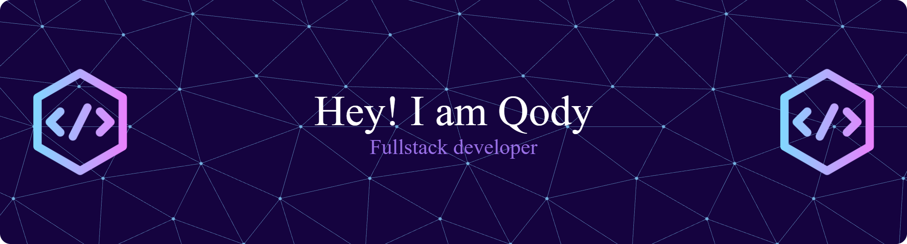

  

###

  

###

<h1 data-importer="text" align="center">Hi, 👋 I'm Qody</h1>

###

<h3 data-importer="text" align="center">I'm a Full Stack Developer passionate about building modern, scalable, and user-friendly web applications.</h3>

###

<h4 data-importer="text" align="left">💻 Interested in Full Stack Developer  ⚙️ Working with JavaScript, React, Next.js, and Node.js  🗄️ Experienced with PostgreSQL, MySQL, and Supabase  🚀 Always learning and exploring new technologies  Building things, solving problems, and growing every day.</h4>

###

<h2 data-importer="text" align="center">💻 Tech Stack</h2>

###

  
  
  
  
  
  
  
  
  
  
  
  
  
  
  
  
  
  
  
  
  
  
  
  
  
  
  

###

<h2 data-importer="text" align="center">📊 GitHub Stats</h2>

###

  
  

###

<h2 data-importer="text" align="center">✉️ Social Media</h2>

###

  
  
  

###

<h2 data-importer="text" align="center">Console</h2>

###

<picture data-importer="pacman">
  <source media="(prefers-color-scheme: dark)" srcset="https://raw.githubusercontent.com/qodyzakee-hammaam/qodyzakee-hammaam/pacman-output/bomberman-contribution-graph-dark.svg?game=bomberman">
  <source media="(prefers-color-scheme: light)" srcset="https://raw.githubusercontent.com/qodyzakee-hammaam/qodyzakee-hammaam/pacman-output/bomberman-contribution-graph.svg?game=bomberman">
  
</picture>

###

###

  

###

  

###